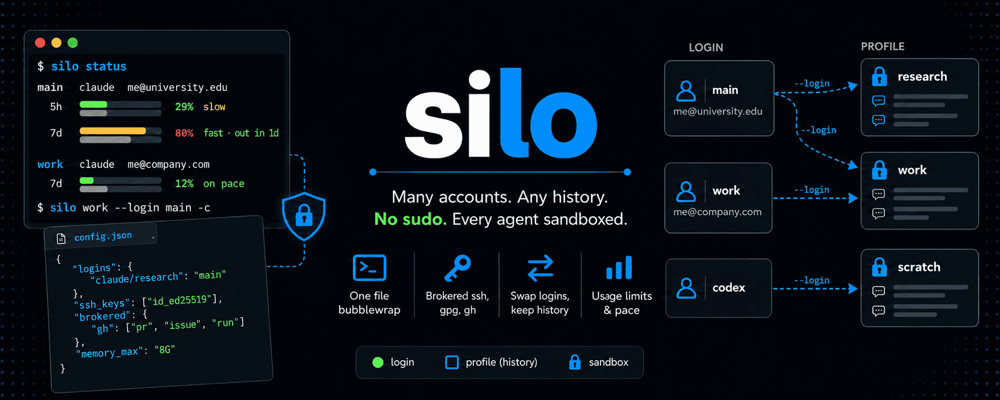

<div align="center">



**One Python file. Many accounts. Every agent CLI in its own bubblewrap sandbox.**

[](https://www.python.org/)
[](https://github.com/flinner/silo/blob/main/silo)
[](LICENSE)
[](https://github.com/containers/bubblewrap)
[](#limitations)
[](#why)

[Install](#install) ·
[Quick start](#quick-start) ·
[Commands](#commands) ·
[Configuration](#configuration) ·
[SSH](#ssh-without-keys-in-the-sandbox) ·
[How it works](#how-it-works) ·
[Limitations](#limitations)

</div>

---

```console
$ silo ls -a
  Tool      Profile    Account                Login            Background
  claude    main       me@university.edu      ok               daemon running
  claude    work       me@company.com         ok               -
  codex     main       me@example.org         ok               -
  codex     scratch    -                      not logged in    -

$ silo work                 # claude, logged in as work, sandboxed
$ silo main --bg 'fix CI'   # a background agent on the other account, at the same time
$ silo-codex main           # codex, same sandbox rules
```

**A profile is a directory.** Each one is a separate `CLAUDE_CONFIG_DIR` /
`CODEX_HOME`, so accounts never overwrite each other's logins and any number
run side by side. Every run is wrapped in [bubblewrap](https://github.com/containers/bubblewrap):

- your home is **read-only**, and logins, other profiles, `gh`/git/cloud
  credentials are **not there at all**;
- only the working directory, the profile, and paths you choose are writable;
- `ssh` works, but **`~/.ssh` is empty** — connections are brokered to the
  host with one key and a host allowlist.

## Why?

Agent CLIs run arbitrary shell commands with your full user rights, and
juggling accounts means copying credential files around. `silo` fixes both
with no root, no containers and no daemon of its own:

| | |
|---|---|
| **No sudo, ever** | Unprivileged user namespaces via `bwrap`. Nothing to install system-wide beyond the packages below. |
| **Accounts side by side** | One config dir per profile. `silo work` and `silo main` run concurrently; claude sessions in different profiles can still list and message each other. |
| **Secrets stay out** | Every tool's login files (all accounts), other profiles, and a configurable list (`~/.config/gh`, `~/.gnupg`, `~/.aws`, ...) are masked inside the sandbox. |
| **ssh without keys** | The agent can `ssh`, `scp` and `git push` to hosts you allow; it can never read the key or your ssh config. |
| **Long-lived agents work** | Background agents (`--bg`), their daemon and Remote Control keep working across runs. |
| **Any CLI** | claude and codex are built in; another agent CLI is one table entry. |

## Install

```bash
curl -fsSL https://raw.githubusercontent.com/flinner/silo/main/install.sh | sh
```

This puts `silo` (and the `silo-codex` alias) in `~/.local/bin` and tells you
if a dependency is missing. Requirements: Linux, `bwrap`, Python 3.9+ with
`click`, `rich` and `prompt_toolkit`:

```bash
sudo pacman -S bubblewrap python-click python-rich python-prompt_toolkit          # Arch
sudo apt install bubblewrap python3-click python3-rich python3-prompt-toolkit    # Debian/Ubuntu
sudo dnf install bubblewrap python3-click python3-rich python3-prompt-toolkit    # Fedora
```

**Updates.** `silo check-update` tells you when a newer version exists and
`silo update` installs it in place, after checking the download compiles.
Normal commands check at most once a day — configurable with
`check_updates = "ask" | "always" | "never"` (`ask` only prints a hint,
`always` installs, `never` stays offline).

## Quick start

```bash
silo init                     # onboarding: import logins, writable paths, ssh key, hidden paths
silo ls -a                    # see the profiles
silo new work                 # a fresh profile ...
silo work auth login          # ... and log it in (codex: silo-codex work login)
silo work                     # run claude as 'work'
```

`silo init` scans what you already have: if claude or codex is logged in, it
offers to import that login as a profile. It then asks which extra paths
should be writable (Tab completes paths), which ssh key to load, which hosts
to allow, which secrets to hide and how to handle updates. Re-run it any time;
Enter keeps the current answer.

## Commands

| Command | Does |
|---|---|
| `init` | Interactive onboarding; writes `~/.config/silo/config.json` |
| `ls [-a]` | Profiles of the selected tool (`-a`: all tools) with account, login and background-daemon state |
| `new NAME [--current]` | Create a profile; `--current` copies this machine's current login |
| `rm NAME [-y]` | Delete a profile, stopping its background agents and ssh broker first |
| `NAME [ARGS...]` | Run the tool as `NAME`; every flag passes through (`silo work -c`, `silo work --bg '...'`) |
| `NAME --shell` | A shell inside `NAME`'s sandbox, to see exactly what the agent sees |
| `check-update` / `update` | Check for / install a newer silo |
| `-t, --tool claude\|codex` | Choose the tool (default: claude; `silo-codex` defaults to codex) |

## Configuration

`~/.config/silo/config.json`, written by `silo init`:

```json
{
  "writable": ["~/code/tmp"],
  "hidden": ["~/.config/gh", "~/.git-credentials", "~/.netrc", "~/.gnupg", "~/.aws"],
  "ssh_key": "id_ed25519",
  "ssh_config": true,
  "ssh_hosts": ["mycluster", "*.lab.example.org"],
  "check_updates": "ask"
}
```

| Key | Default | Meaning |
|---|---|---|
| `writable` | `[]` | Extra paths writable inside the sandbox (the cwd and the profile always are) |
| `hidden` | common secret paths | Masked inside the sandbox, on top of every tool's login files |
| `ssh_key` | `""` | Key in `~/.ssh` loaded into the profile's private ssh-agent; empty = no ssh |
| `ssh_config` | `false` | Let brokered ssh use your `~/.ssh/config` (identity lines stripped) |
| `ssh_hosts` | `[]` | Allowed ssh destinations, globs ok; empty = any host |
| `check_updates` | `ask` | `ask` \| `always` \| `never` |

Environment overrides: `SILO_ROOT` (default `~/.config/silo`), `SILO_SSH_KEY`.

## SSH without keys in the sandbox

Inside the sandbox `~/.ssh` is an empty directory and `/usr/bin/ssh` is a
dozen-line shim. It hands its arguments and its stdin/stdout/stderr (the actual
file descriptors, so interactive terminals work) to a broker running on the
host, which:

1. **vets the arguments** — refuses `-F`, `-i`, `-E`, `-S`, `-G`, `-J`, `-v`,
   any `-o` outside a small safe list (so no `ProxyCommand` or `LocalCommand`),
   unix-socket forwards, and destinations outside `ssh_hosts`;
2. **runs the real ssh** with a per-profile `ssh-agent` holding only your
   chosen key, and optionally your ssh config with every `IdentityFile`,
   `IdentityAgent` and `CertificateFile` line removed;
3. **ties lifetimes together** — if the agent's ssh is killed, the host ssh
   and anything it spawned are killed too.

`scp`, `rsync -e ssh` and `git` over ssh go through the same shim. The private
key never enters the sandbox; the agent can use it only against hosts you allow.

## How it works

```
 host                                           sandbox (bwrap, per run)
┌───────────────────────────────┐            ┌──────────────────────────────────┐
│ silo NAME ...                 │   exec     │ claude / codex                   │
│  · reads config.json          │ ─────────► │  CLAUDE_CONFIG_DIR / CODEX_HOME  │
│  · starts broker + ssh-agent  │            │   = ~/.config/silo/<tool>/NAME   │
│                               │            │                                  │
│ ssh broker (per profile)      │ ◄───────── │ /usr/bin/ssh  = shim             │
│  · vets argv, runs real ssh   │  unix sock │ ~/.ssh        = empty            │
│  · ssh-agent with ONE key     │  + fds     │ / and ~       = read-only        │
│                               │            │ logins, secrets = masked         │
│ $XDG_RUNTIME_DIR (hidden)     │            │ cwd, profile, writable = rw      │
│ host ssh-agent, dbus (hidden) │            │ /tmp = NAME/tmp (persistent)     │
└───────────────────────────────┘            └──────────────────────────────────┘
```

**Profiles.** `~/.config/silo/<tool>/<name>/` is the tool's whole config
directory. A new profile copies your settings (`settings.json`,
`config.toml`) and symlinks shared instructions (`CLAUDE.md`, `AGENTS.md`,
skills), so edits to those apply everywhere.

**Mount layout.** `/` is bound read-only; `/tmp` is the profile's own
persistent directory; `$XDG_RUNTIME_DIR` is replaced by an empty tmpfs (it
holds the host ssh-agent, the session bus and editor/terminal servers — all
ways out); `~/.config/silo` is masked except the active profile; secrets are
masked with `/dev/null` or an empty tmpfs; then the working directory, the
profile and your `writable` paths are bound read-write.

**Background agents and Remote Control.** Claude Code's background daemon
listens on a socket under `/tmp`. Because each profile's `/tmp` persists,
`silo work --bg 'task'` keeps running after you exit, and the next
`silo work agents` finds it. Remote Control works unchanged.

**Talking between sessions.** Claude Code discovers peers through a session
registry and sockets, and ignores peers in another PID namespace. silo shares
the registry (`~/.claude/sessions`) and socket directory across all profiles
and keeps the host PID namespace, so sessions of different accounts — and
your unsandboxed claude — can list and message each other.

**Adding a tool.** A tool is one `Tool(...)` entry: binary, the environment
variable that relocates its config, files to copy or link into new profiles,
its login files, and how to read the account email.

## Limitations

- Linux only (bubblewrap); unprivileged user namespaces must be enabled.
- The network namespace is shared (agents need the network), so abstract
  unix sockets such as X11's remain reachable.
- Window resizes are not forwarded to brokered interactive ssh sessions.
- Your home is readable except the hidden paths; add anything sensitive to
  `hidden`.
- `--shell` must be the only argument after the profile name.

## License

[MIT](LICENSE)
